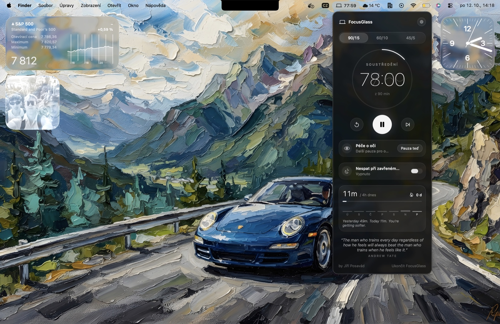
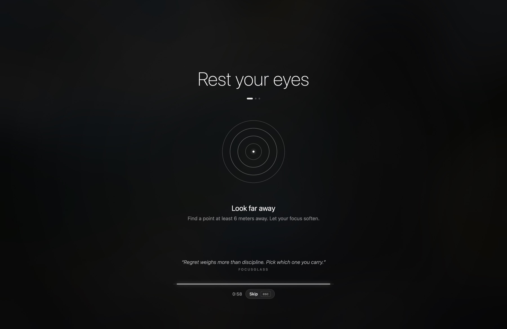
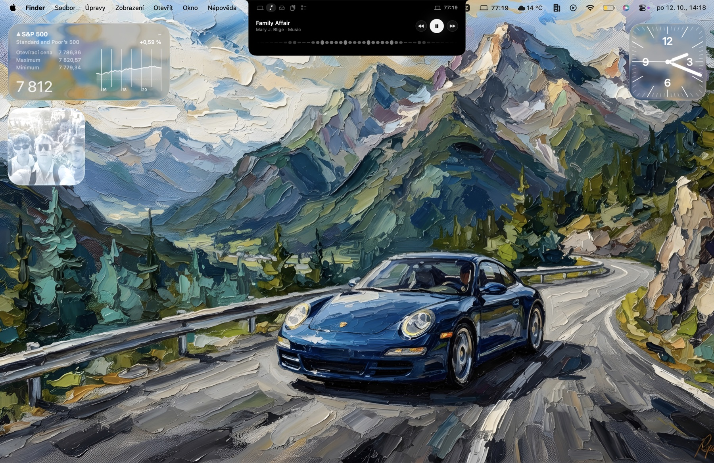
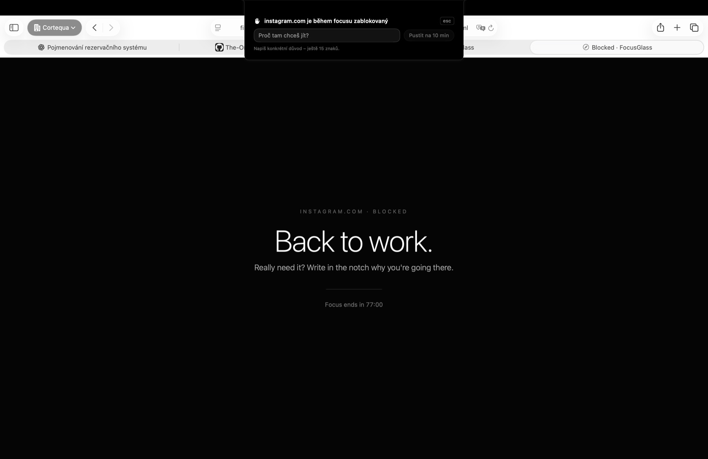
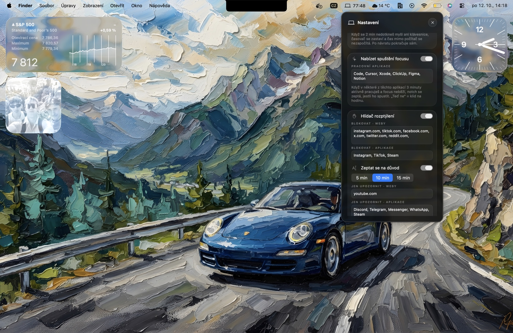
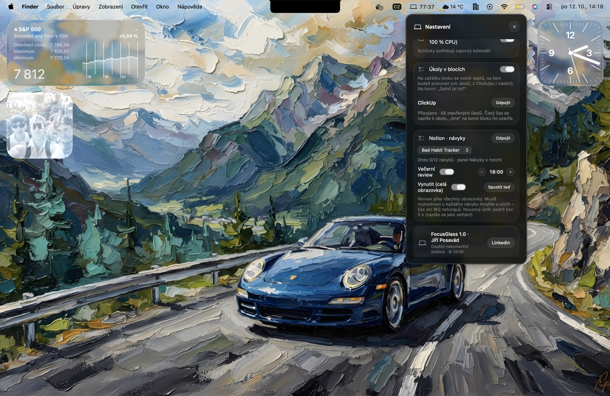

# FocusGlass

Malá aplikace pro Mac, která žije v horní liště a pomáhá ti **soustředit se** a **šetřit oči**.

## Instalace

Potřebuješ Mac s macOS 14 Sonoma nebo novějším (Apple Silicon i Intel).

1. Stáhni **[FocusGlass.dmg](../../releases/latest)**.
2. Otevři ho a přetáhni **FocusGlass** do složky **Applications**.
3. V Applications klikni na FocusGlass **pravým tlačítkem → Otevřít → Otevřít**.
   (Stačí poprvé. Aplikace není z App Storu, proto se macOS zeptá.)
4. V horní liště vedle hodin se objeví ikona oka. Klikni na ni a stiskni ▶.

> Hlásí macOS „aplikace je poškozená“? V Terminálu spusť
> `xattr -cr /Applications/FocusGlass.app` a otevři ji znovu.

**Spouštět sama po přihlášení:** ozubené kolo → *Spustit po přihlášení*.
**Odinstalace:** ukonči aplikaci (ikona v liště → *Ukončit*) a přesuň ji z Applications do koše.

## Co aplikace umí

### Soustředění
- **Časovač** s profily 90/15, 60/10 a 45/5 minut.
- **Péče o oči (20-20-1):** po 20 minutách práce na minutu ztmavne obrazovka a provede tě krátkým cvičením. Přeskočíš ho klávesou Esc.

- **Velká pauza** po skončení bloku.
- **Detekce odchodu:** když nic nedotkneš, časovač se sám zastaví.
- **Statistiky:** čas práce dnes, denní cíl, série dní, graf týdne.

### Notch (výřez nahoře uprostřed)
Klikni na něj, nebo stiskni **⌃⌥ mezerník**.

| Panel | Co dělá |
|---|---|
| **Focus** | časovač, statistiky, nejbližší schůzka |
| **Hudba** | ovládání Apple Music a Spotify |
| **Odkladiště** | přetáhni na něj soubor a vytáhni ho kamkoli. Screenshoty a stažené soubory se tam přidají samy |
| **Schránka** | posledních 10 zkopírovaných textů |

### Kolo souborů
Začni táhnout soubor (z Finderu, z Plochy, z odkladiště) a **ťukni na klávesu** – u kurzoru se otevře kolo.
Soubor pustíš na lístek; kolo zůstane otevřené, dokud ho nepustíš. Na střed nebo Esc = zrušit.

| Klávesa | Kolo | Co nabízí |
|---|---|---|
| ⇧ | **Převést** | obrázky, video, zvuk, PDF, dokumenty, tabulky, titulky, archivy, e-knihy |
| ⌘ | **Nástroje** | komprese, ořez, střih, krytí, OCR, metadata a další podle druhu souboru |
| ⌃ | **Akce** | AirDrop, Float, Kopírovat, Přesunout, Cesta, Terminál |

Výsledek se uloží vedle originálu („foto (PNG).png“, nikdy nepřepíše nic existujícího) a objeví se v odkladišti.
Klávesy změníš v nastavení. **⌃⌥K** otevře kolo pro soubory vybrané ve Finderu (šipky, Enter, Tab přepíná kola).
Podrž **⌥** při výběru nástroje a spustí se hned s výchozími hodnotami.

Co umí nástroje: obrázky (komprese na cílovou velikost, metadata a poloha, úpravy, anotace, pozadí, ořez, krytí
obličejů a citlivého textu, vystřižení, PDF a koláž z více obrázků), PDF (komprese, stránky, rozdělení, sloučení,
heslo, vodoznak, krytí textu, obrázky, OCR), video a zvuk (komprese, střih, ořez, rychlost, normalizace hlasitosti…),
titulky, tabulky, dokumenty a e-knihy. Úplný přehled a architektura: [docs/CONVERT.md](docs/CONVERT.md).

Většina běží jen na tom, co je v macOS. Pro MKV, WebM, MP3, OGG a všechny nástroje videa a zvuku potřebuješ
`brew install ffmpeg`; WebP a AVIF `brew install webp libavif`. Co chybí, je v kole šedé a řekne ti, co doinstalovat.

### Hlídač rozptýlení
Během focusu tě notch upozorní, když otevřeš zakázaný web nebo aplikaci (Instagram, TikTok, Steam…).
Seznamy si upravíš v nastavení.

### Další
- **Připojit ke schůzce** jedním klikem (Teams, Zoom, Meet, Webex), 2 minuty před začátkem.
- **Nespat při zavřeném víku** (Mac zůstane vzhůru).
- **Baterie:** animace při nabíjení a varování při 20 % a 10 %.
- **Žrouti výkonu:** nabídne ukončení aplikace, která bere moc paměti nebo procesoru.
- **Úkoly a návyky** z ClickUp a Notion (volitelné, po připojení v nastavení).

### Klávesové zkratky
| Zkratka | Akce |
|---|---|
| ⌃⌥ mezerník | otevřít / zavřít notch |
| ⌃⌥ ↩ | start / pauza |
| ⌃⌥ V | schránka |

## Co aplikace není

- **Není v App Storu** a není notarizovaná Applem, proto první spuštění vyžaduje pravé tlačítko → Otevřít.
- **Nemá ikonu v Docku.** To je záměr, žije jen v liště.
- **Neběží na Windows ani na starším macOS než 14.**
- **Nemá účet, server ani cloud.** Data zůstávají v tvém Macu. Do internetu volá jen Notion a ClickUp, a to jen když je sám připojíš.
- **Neovládá iPhone přímo.** Šedý iPhone během focusu jde, ale přes zkratky, viz [návod](docs/FOCUS-MODE.md).
- **Hudba jen z Apple Music a Spotify.** Hlídač rozptýlení hlídá weby jen v Safari, Chrome, Arc, Brave a Edge.
- **Není pro komerční použití** (viz licence níže).

## Další dokumentace

- [Nerušit a šedý iPhone během focusu](docs/FOCUS-MODE.md)
- [Vývoj, sestavení a architektura](docs/DEVELOPMENT.md)

## Autor a licence

**Jiří Posavád** · [LinkedIn](https://www.linkedin.com/in/jiří-posavád/)

Jen **osobní, nekomerční použití**, viz [LICENSE](LICENSE). Bez písemného svolení autora je zakázáno
aplikaci prodávat, šířit (v původní i upravené podobě) a odstraňovat jméno autora.
